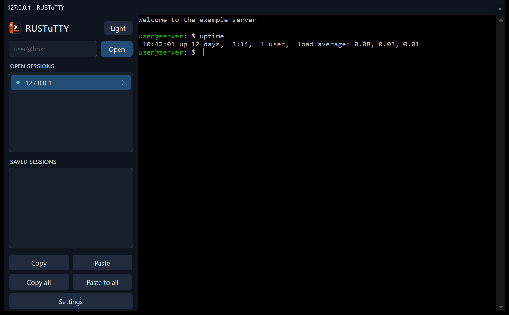
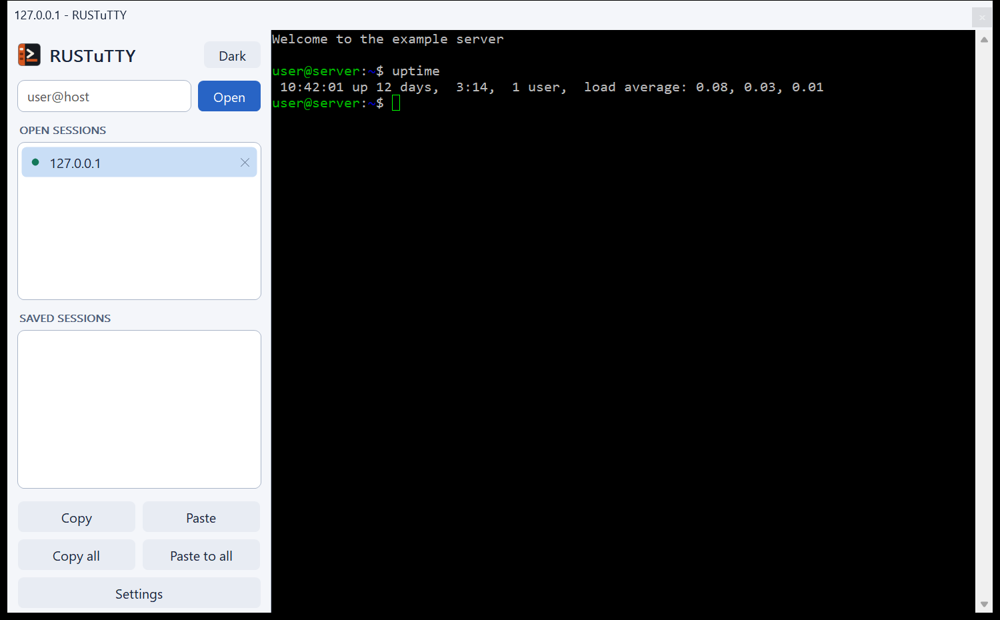
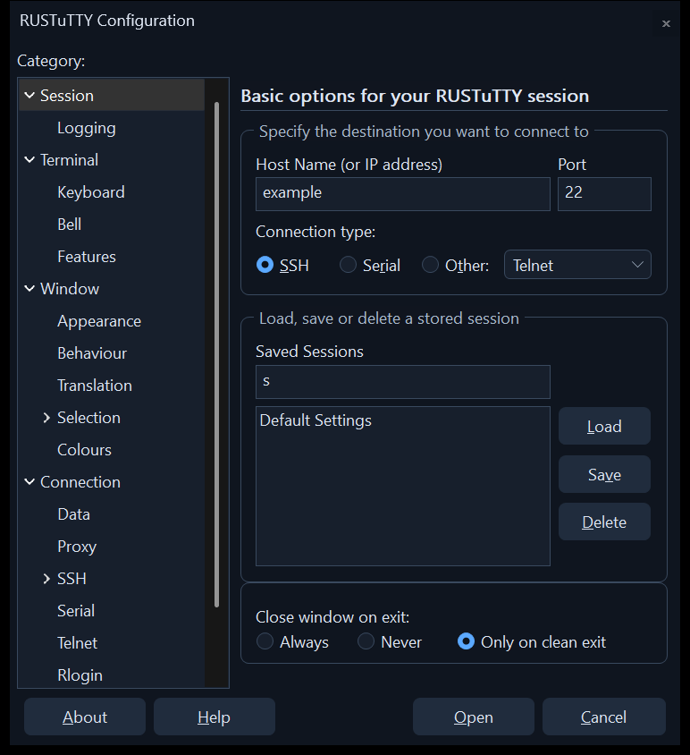

#  RUSTuTTY

**All your terminal sessions in one window.** An unofficial rewrite of PuTTY in
Rust for Windows, with PuTTY's settings, a session list down the left, and dark
and light themes.

**[Website](https://optimusprime-nn.github.io/RUSTuTTY/)** ·
**[Documentation](https://optimusprime-nn.github.io/RUSTuTTY/Home.html)** ·
**[Wiki](https://github.com/optimusprime-nn/RUSTuTTY/wiki)** ·
**[Download](https://github.com/optimusprime-nn/RUSTuTTY/releases)**

| Light | Settings |
| --- | --- |
|  |  |

## Download

Get the installer or the portable zip from
[Releases](https://github.com/optimusprime-nn/RUSTuTTY/releases). The installer
is per-user and needs no administrator rights. It's unsigned for now, so Windows
SmartScreen may warn about it: choose More info, then Run anyway. You can check
a download against `SHA256SUMS.txt` in the same release.

This is a beta. The automated tests are thorough, but some things still need
more real-world use, including restarting SSH sessions and SSH special commands.
Please report what you find in [Issues](https://github.com/optimusprime-nn/RUSTuTTY/issues).

## What it is

PuTTY's programs rewritten in Rust, with terminal sessions in one window, listed
on the left. Every session runs inside one process. SSH and its cryptography come
from [russh](https://crates.io/crates/russh), the terminal from
[alacritty_terminal](https://crates.io/crates/alacritty_terminal), and the rest
is written here, following PuTTY's source and file formats.

| PuTTY | Here | Notes |
| --- | --- | --- |
| PuTTY | `rustutty` | Windows program, many sessions in one window |
| Plink | `plink` | Console sessions, scripts and tunnels |
| PSCP | `pscp` | SFTP, or the old SCP protocol with `-scp` or when there's no SFTP |
| PSFTP | `psftp` | Interactive, or `-b` for a batch file |
| PuTTYgen | `puttygen` | Command line, like PuTTY's `cmdgen`. No window |
| Pageant | `pageant` | Runs in a console. No tray icon |

It reads your PuTTY saved sessions and trusted host keys, and never changes them.
Anything saved here goes in `HKCU\Software\PuTTYDeck`, and a session saved there
takes the place of a PuTTY session with the same name.

## Using it

Type `user@host` at the top left and press Enter, or double-click a saved
session. Right-click the saved sessions list to change a session's settings or
make a new one. `telnet://host`, `rlogin://host`, `supdup://host`, `raw://host:port`
and `serial://COM3` also work. Login prompts appear in the terminal, as they do
in PuTTY.

The window starts dark. The button at the top of the sidebar, or Light Appearance
in the window menu, switches between dark and light, and the choice is kept.

    rustutty -ssh user@host
    rustutty -load "saved session"
    rustutty -i key.ppk -L 8080:web:80 -D 1080 user@host

### Copy and paste

| Action | How |
| --- | --- |
| Copy | Select with the mouse: it's copied immediately |
| Copy | `Ctrl+C` while text is selected, `Ctrl+Shift+C`, or the Copy button |
| Paste | Right-click, `Ctrl+V`, `Ctrl+Shift+V`, or the Paste button |
| Copy a whole session's output | Copy all button |
| Paste into every session | Paste to all button (asks first) |

`Ctrl+C` with nothing selected is an interrupt. `Ctrl+V` goes to the program in
full-screen apps such as vim, and `Ctrl+Shift+V` always pastes. When a program
uses the mouse, hold Shift to select text.

### Keyboard

| Keys | Action |
| --- | --- |
| `Ctrl+Tab` / `Ctrl+Shift+Tab` | Next / previous session |
| `Ctrl+Shift+1` to `9` | Go to session 1 to 9 |
| `Ctrl+Shift+T` | New session |
| `Ctrl+Shift+D` | Duplicate session |
| `Ctrl+Shift+W` | Close session |
| `Shift+PgUp` / `Shift+PgDn` | Scroll back and forward |

Right-click a session in the list for more. Its X or a middle-click closes it,
and the X asks first if the session is live and `WarnOnClose` is on. A bell
in a background session puts a `*` next to it.

## What's included

- Protocols: SSH-2, Telnet, Rlogin, SUPDUP, raw and serial
- Proxies: SOCKS 4 and 5, HTTP with Basic or Digest login, telnet, local command,
  and SSH
- Forwarding: local, remote and dynamic ports, Pageant, and X11 with MIT or XDM
  logins
- Login: passwords, keyboard-interactive, keys, OpenSSH certificates, Pageant and
  PuTTY's authentication plugins
- Keys: `.ppk` versions 2 and 3, encrypted or not, and OpenSSH files
- Logging, remote commands, environment variables, keepalives and per-session
  colours and fonts

## What isn't

`deck-core/src/options.rs` lists every one of PuTTY's saved settings as working,
not applicable, or not done with the reason, and a test checks that list against
PuTTY's. A setting that isn't done is still kept, so a saved session loses
nothing. What's left can't be done with the libraries this is built on:

- GSSAPI and Kerberos login, SSH-1 and single DES, which russh doesn't have.
  A session set to SSH-1 only is refused rather than connected over SSH-2
- PuTTY's workarounds for old servers: russh makes those choices, and may refuse
  very old servers
- Background colour erase, blinking text, right-to-left text and PuTTY's
  double-width and line-drawing options, which alacritty_terminal has no way to do

The tools also differ: `puttygen` is command line only, `pageant` runs in a
console with no tray icon, and the Rlogin window size is sent without waiting for
the server's urgent request.

Some things differ on purpose, for safety:

- Every session keeps at least 10,000 lines of scrollback, even a PuTTY session
  saved with PuTTY's 2000, so a long install or log keeps its start

- Pasting anything with a line end asks first, even one at the end of a single
  line, unless the program is using bracketed paste. `PasteWarnLines` turns
  this off
- An HTTP proxy only gets a password if it offers Basic or Digest, and Basic
  shows a warning
- `pscp -scp` refuses files other than the one asked for. Wildcards need `-unsafe`
- A proxy or pre-connect command won't run if a host name, user name or password
  it uses has a character `cmd.exe` would act on
- Pageant is reached by its window message, not its named pipe
- `puttygen` asks for a passphrase on a new key and keeps a converted key's.
  `--no-passphrase` writes one without
- Session logs hold what the host sent, not this end's prompts
- Hosts can't hold the display back with synchronized updates

And some differ for other reasons:

- Algorithms PuTTY lists below "warn" aren't offered at all, because russh has
  nowhere to stop and ask. A session left with none it can use is refused,
  with a message saying which list to change
- `Ctrl+Shift+C` and `V` always work, whatever `CtrlShiftCV` says
- Connection sharing works between sessions in one program. It can't join a
  connection held by a separate PuTTY, and forwardings on a joining session
  aren't set up
- Rich text copying keeps the text and font, not its colours
- Resizing a session can't change its font

## Following PuTTY

A scheduled job checks PuTTY's main branch every day and lists new commits in an
issue. Each one is reviewed, and what applies is ported by hand, so security
fixes and new features can follow PuTTY while the code stays a separate rewrite.
`.putty-reviewed` holds the last commit reviewed.

## Releasing

Set the version in `crates/rustutty`, `crates/deck-tools` and `crates/deck-setup`,
then push a matching tag such as `v1.0.0`. The Release workflow tests and builds
everything and publishes it. Add `-beta.1` or similar for a pre-release.

## Building

Needs Rust and the Visual Studio 2022 Build Tools (C++).

    build.cmd

The results are in `dist`.

## Testing

    cargo test -p deck-core -p deck-tools
    cargo test -p rustutty --features test-hooks
    cargo test -p deck-core --test sftp -- --ignored --test-threads=1

The first two run real servers on localhost. The app tests drive a special build
that opens off-screen, can't take focus and has a private clipboard, so they're
safe to run while you use the PC. The third has the real PuTTY's `plink.exe` log
in with key files and a Pageant from here, so it needs PuTTY installed, the debug
tools built, and no Pageant running.

## Licence

RUSTuTTY is an unofficial program, not connected with the PuTTY project. It
follows PuTTY, copyright Simon Tatham and contributors, under the MIT
licence: see `LICENCE`. It is unofficial, and not a PuTTY project release. The
crates it's built on keep their own licences, and each release's `LICENCE.txt`
includes their notices. A build of your own gets them by running
`python scripts/notices.py` first.
