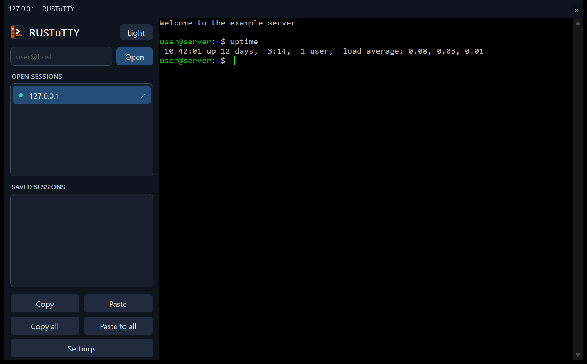
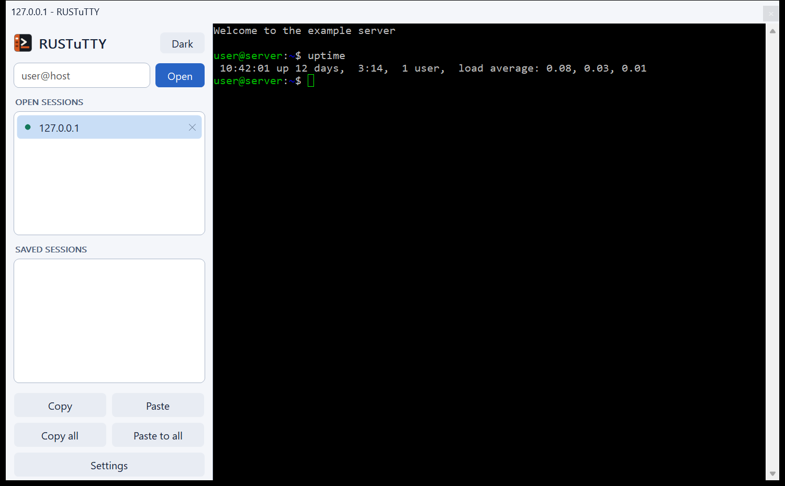

# Getting started

## Your first connection

Start RUSTuTTY, type `user@host` in the box at the top left, and press
**Enter** or click **Open**. The session's terminal fills the right of the
window, and the session appears under **Open sessions**.

The login happens in the terminal, as in PuTTY: if the server asks for a
password, type it there. The first time you reach a server, RUSTuTTY shows its
host key fingerprint and asks whether to trust it, exactly as PuTTY does.

The box takes more than SSH:

| Type | Connects with |
| --- | --- |
| `host` or `user@host` | SSH, port 22 |
| `user@host:2222` | SSH on port 2222 |
| `telnet://host` | Telnet |
| `rlogin://host` | Rlogin |
| `supdup://host` | SUPDUP |
| `raw://host:port` | A raw TCP connection |
| `serial://COM3` | The serial port COM3 |

## Saved sessions

The list under **Saved sessions** holds the sessions you saved in PuTTY, plus any
saved in RUSTuTTY. Double-click one to open it.

Right-click the list to:

- **Settings...** change the settings of the session under the pointer
- **New session...** fill in a new session from scratch

Both open the [settings window](Settings.md), where **Save** keeps the session
and **Open** connects to it.

A session saved in RUSTuTTY with the same name as a PuTTY session takes its
place in RUSTuTTY's list. The PuTTY session itself is untouched.

## Several sessions at once

Each connection you open is added to **Open sessions**, and stays running
while you look at another. Click a session to show it. A `*` next to a
session means it rang the bell while you weren't looking at it.

See [The window](The-Window.md) for the keyboard shortcuts, copy and paste,
and everything on the window menu.

## Dark and light

RUSTuTTY starts dark. The **Light** or **Dark** button at the top of the
sidebar switches between them, as does **Light Appearance** or **Dark Appearance** on the
window menu. Your choice is kept for next time.

| Dark | Light |
| --- | --- |
|  |  |

## Logging in with a key

Use a `.ppk` key from PuTTYgen or an OpenSSH key file. Either:

- set it in the session's settings, under **Connection > SSH > Auth > Credentials**, or
- start RUSTuTTY with `-i`: `rustutty -i key.ppk user@host`, or
- load it into Pageant, PuTTY's or [RUSTuTTY's](Tools.md#pageant), and RUSTuTTY will use it
