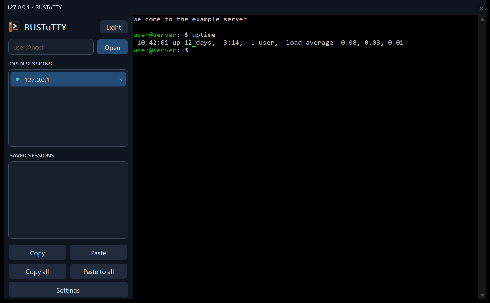

# RUSTuTTY documentation

RUSTuTTY is an unofficial rewrite of PuTTY in Rust for Windows. All your
terminal sessions run in one window, listed down the left, with PuTTY's
settings and its command-line tools.

## Using RUSTuTTY

- [Installing](Installing.md): the installer, the portable zip, and removing it
- [Getting started](Getting-Started.md): your first connection, and the sessions PuTTY already saved
- [The window](The-Window.md): the session list, copy and paste, keyboard shortcuts and the window menu
- [Settings](Settings.md): every page of the settings window, and where settings are kept
- [Command line](Command-Line.md): starting sessions from a shortcut or a script
- [Tools](Tools.md): Plink, PSCP, PSFTP, PuTTYgen and Pageant

## Knowing what to expect

- [Differences from PuTTY](Differences-from-PuTTY.md): what isn't done, and what's done differently on purpose
- [Troubleshooting](Troubleshooting.md): common problems and how to report one

## Working on RUSTuTTY

- [Building and testing](Building-and-Testing.md): building from source, the tests, releasing, and following PuTTY

RUSTuTTY is not connected with the PuTTY project. It follows PuTTY, copyright
Simon Tatham and contributors, under the MIT licence.
