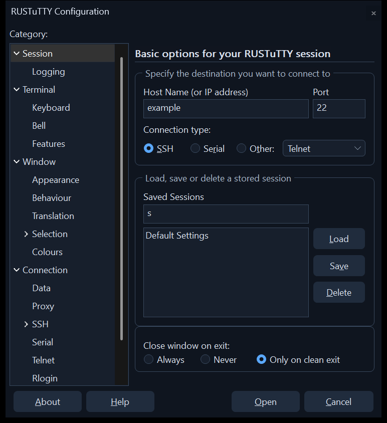

# Settings

RUSTuTTY's settings window is PuTTY's configuration dialog: the same pages, in
the same order, with the same controls. If you know where a setting lives in
PuTTY, it's in the same place here.

## Opening it

| To | Do |
| --- | --- |
| Make a new session | Right-click **Saved sessions** and choose **New session...**, or choose **New Session...** on the window menu |
| Change a saved session | Right-click it under **Saved sessions** and choose **Settings...** |
| Change the session you're using | The **Settings** button, or **Change Settings...** on the window menu |

The window can be resized: drag any edge or corner, and the pages grow to fit.

## Saving a session

On the **Session** page, type a name under **Saved Sessions** and click
**Save**. **Load** fills the window from a saved session, and **Delete**
removes one. Delete only removes RUSTuTTY's own copy: a session saved in PuTTY
stays in PuTTY. **Open** connects with the settings as they are, whether or not
you saved them.

Changing a running session applies straight away. Settings that only make sense
before connecting, such as the host name or the protocol, are left out while a
session runs, as in PuTTY.

## The pages

| Page | What it covers |
| --- | --- |
| Session | Host, port and protocol, saved sessions, and what happens when the session ends |
| Session > Logging | Writing what the session shows, or all its traffic, to a file |
| Terminal | Line wrapping, local echo and line editing, answerback |
| Terminal > Keyboard | What Backspace, Home/End, the function keys and the keypad send |
| Terminal > Bell | What a bell does, and quietening a host that rings too often |
| Terminal > Features | Turning off things a host may ask for, such as mouse reporting, resizing and title changes |
| Window | Size in columns and rows, scrollback, and the scrollbar |
| Window > Appearance | Font, cursor, and the gap around the text |
| Window > Behaviour | Title, close warnings, Alt key behaviour, full screen, paste warnings, and **Save window size on exit** |
| Window > Translation | The character set, and line-drawing characters |
| Window > Selection | Mouse buttons, selection modes and pasting |
| Window > Selection > Copy | Copying as rich text, and character classes for word selection |
| Window > Colours | Every colour, and how bold is shown |
| Connection | Keepalives, TCP options and the IP version |
| Connection > Data | User name, terminal type and speeds, and environment variables |
| Connection > Proxy | SOCKS 4 and 5, HTTP, telnet, local command or SSH proxies |
| Connection > SSH | Remote command, compression, and connection sharing |
| Connection > SSH > Kex | Key exchange algorithms, and when to rekey |
| Connection > SSH > Host keys | Host key algorithms, and keys to accept for this session |
| Connection > SSH > Cipher | Encryption algorithms, in order of preference |
| Connection > SSH > Auth | Banner, Pageant, keyboard-interactive, and agent forwarding |
| Connection > SSH > Auth > Credentials | Private key, certificate, and authentication plugin |
| Connection > SSH > TTY | Whether to ask for a terminal, and the terminal modes sent |
| Connection > SSH > X11 | X11 forwarding and its authentication |
| Connection > SSH > Tunnels | Local, remote and dynamic port forwarding |
| Connection > SSH > Bugs | Workarounds for servers with known faults |
| Connection > Serial | Port, speed, data bits, stop bits, parity and flow control |
| Connection > Telnet, Rlogin, SUPDUP | Each protocol's own options |

Some pages only appear for the protocol they belong to, as in PuTTY.

A few settings are kept but have no effect here, because the libraries
RUSTuTTY is built on can't do them. They're listed in
[Differences from PuTTY](Differences-from-PuTTY.md). A session that uses them
still keeps them, so nothing is lost if you open it in PuTTY again.

## Settings that are RUSTuTTY's own

| Setting | Where | Default |
| --- | --- | --- |
| Save window size on exit | Window > Behaviour | On |
| Light or dark appearance | The button at the top of the sidebar | Dark |

## Where settings are kept

RUSTuTTY reads from PuTTY's place in the registry and writes only to its own:

| Key | Holds | RUSTuTTY |
| --- | --- | --- |
| `HKCU\Software\SimonTatham\PuTTY\Sessions` | PuTTY's saved sessions | Reads, never changes |
| `HKCU\Software\SimonTatham\PuTTY\SshHostKeys` | Host keys PuTTY trusts | Reads, never changes |
| `HKCU\Software\PuTTYDeck\Sessions` | Sessions saved in RUSTuTTY | Reads and writes |
| `HKCU\Software\PuTTYDeck\SshHostKeys` | Host keys trusted in RUSTuTTY | Reads and writes |
| `HKCU\Software\PuTTYDeck` | Theme and window size | Reads and writes |

A host key trusted in either PuTTY or RUSTuTTY is trusted by RUSTuTTY.

To move your RUSTuTTY sessions to another PC, export `HKCU\Software\PuTTYDeck`
with Registry Editor and import it there.
