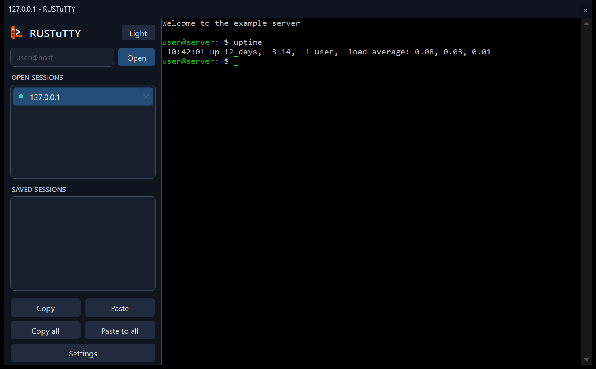

# The window

The window has two parts. On the left, the sidebar: the theme button, a box to
type a new connection into, **Open sessions**, **Saved sessions**, and the copy
and paste buttons. On the right, the terminal of the session you've picked.

## Open sessions

| To | Do |
| --- | --- |
| Show a session | Click it |
| Close a session | Click its **X**, or middle-click it |
| See a session's menu | Right-click it |
| Notice a background bell | Look for a `*` next to the session |

The **X** asks first if the session is still connected and **Warn before
closing window** is on (Window > Behaviour in [Settings](Settings.md)), which it is
unless you turned it off.

When a session ends, it stays in the list so you can read what was on screen.
**Restart Session** on the window menu connects it again.

## Copy and paste

| Action | How |
| --- | --- |
| Copy | Select with the mouse: it's copied straight away |
| Copy | `Ctrl+Shift+C`, or the **Copy** button |
| Paste | Right-click, `Ctrl+Shift+V`, or the **Paste** button |
| Copy, paste | `Ctrl+Insert`, `Shift+Insert`, as in PuTTY |
| Copy a whole session's output | The **Copy all** button |
| Paste into every session | The **Paste to all** button, which asks first |

The buttons sit at the bottom of the sidebar, with **Settings**, which changes
the settings of the session you're looking at.

As in PuTTY, plain `Ctrl+C` and `Ctrl+V` go to the program: `Ctrl+C` interrupts
and `Ctrl+V` reaches the shell, whether or not text is selected. When a program
uses the mouse, hold **Shift** to select text.

Pasting anything with a line end asks first, because each line end presses
Enter. That includes a single command copied with its newline, which would
otherwise run before you could read it. Programs that use bracketed paste are
trusted to handle it themselves. **Warn before pasting line ends** under
Window > Behaviour turns the question off.

## Keyboard shortcuts

| Keys | Action |
| --- | --- |
| `Ctrl+Tab` / `Ctrl+Shift+Tab` | Next / previous session |
| `Ctrl+Shift+1` to `Ctrl+Shift+9` | Go to session 1 to 9 |
| `Ctrl+Shift+T` | New session: puts the cursor in the `user@host` box |
| `Ctrl+Shift+D` | Duplicate this session |
| `Ctrl+Shift+W` | Close this session |
| `Shift+PgUp` / `Shift+PgDn` | Scroll back and forward half a screen |
| `Ctrl+PgUp` / `Ctrl+PgDn` | Scroll back and forward a line |
| `Ctrl+Shift+PgUp` / `Ctrl+Shift+PgDn` | Go to the top or bottom of the scrollback |
| `Ctrl+Break` | Send a break, for Telnet and serial sessions |
| `Ctrl+Pause` | Application keypad mode on or off |
| `Alt+Enter` | Full screen, if turned on in Window > Behaviour |

Selecting works as in PuTTY: double-click selects a word and triple-click a
line, and dragging on from either goes by words or lines. Drag past the top or
bottom of the window to scroll while selecting. The middle button (or the right
one, in xterm style) moves the nearer end of a selection.

## The window menu

Right-click the title bar, or hold **Ctrl** and right-click the terminal, for
PuTTY's menu. `Alt+Space` opens it too if **System menu appears on ALT-Space**
is ticked under Window > Behaviour. Right-clicking a session in the list shows
the same menu with **Close session** added.

| Entry | What it does |
| --- | --- |
| Copy, Paste | As above |
| Special Command | Sends a protocol command: Break, Are You There, a signal, and so on. Only shown for protocols that have them |
| Event Log | A window of what the connection did, with times: where it connected, the host key, the login, the channel and forwarding set up, and why it ended. It keeps up while open, and **Copy all** copies it |
| New Session... | Opens the settings window for a new session |
| Restart Session | Connects a session that has ended |
| Duplicate Session | Opens another session with the same settings |
| Saved Sessions | Opens a saved session |
| Change Settings... | Changes this session's settings while it runs. Some, such as the host, can only change before connecting |
| Copy All to Clipboard | Copies the session's whole scrollback |
| Clear Scrollback | Forgets what's scrolled off the top |
| Reset Terminal | Puts the terminal back as it was at the start |
| Full Screen | Fills the screen with the terminal |
| Light / Dark Appearance | Switches the theme |
| Help | Opens this documentation in your browser |
| About RUSTuTTY | The version and licence |

## The window's size

RUSTuTTY remembers its size, and whether it was maximised, when you close it,
and opens the same way next time. To stop that, untick **Save window size on exit** under
Window > Behaviour in [Settings](Settings.md).
